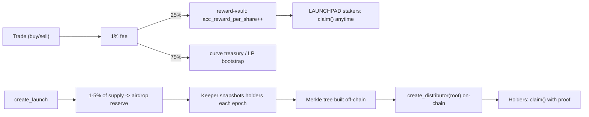

# Memecoin Launchpad — Solana / Anchor

A pump.fun-style bonding-curve launchpad with two reward loops:

1. **LAUNCHPAD stakers earn 25% of every trade's fee**, across every memecoin
   launched on the platform — paid out via a pull-based staking vault, not a
   daily push airdrop (see `programs/reward-vault`).
2. **Each memecoin's own holders get 1-5% of that coin's supply**, distributed
   epoch-by-epoch via Merkle-proof claims (see `programs/merkle-distributor`).

## Programs

| Program | Purpose |
|---|---|
| `launchpad-core` | Token creation, constant-product bonding curve (buy/sell), fee split, migration flag |
| `reward-vault` | Staking pool for the LAUNCHPAD token; accrual-per-share SOL reward accounting |
| `merkle-distributor` | Reusable per-memecoin, per-epoch holder-airdrop claims |

Off-chain: `app/build-merkle-tree.ts` — the "keeper" script that snapshots
holder balances, computes entitlements, and builds the Merkle tree whose root
gets posted on-chain.

## Frontend

`frontend/` is a Next.js 14 + Tailwind app (wallet connect, launch list,
create-launch form, trading page with a bonding-curve chart, staking
dashboard, holder-airdrop claims). It's built and verified — `npm install &&
npm run build` succeeds in this repo as shipped. It currently reads
`lib/demo-data.ts` for the launch list rather than a live chain; wire it up
to your deployed programs by following `DEVNET_DEPLOY.md`.

Current implementation note: the launch list now reads live Curve accounts
from the configured cluster. Names and symbols remain mint-address based until
a metadata indexer is added. The ordered validation plan is in
`DEVNET_RELEASE_RUNBOOK.md`.

## Setup

This was written and reviewed for correctness but **not compiled** — the
sandbox this was built in has no Solana/Rust toolchain and a locked-down
network (it can reach crates.io and GitHub, but not Solana's install
scripts). Build it for real with:

```bash
# 1. Install Rust
curl --proto '=https' --tlsv1.2 -sSf https://sh.rustup.rs | sh

# 2. Install Solana CLI (check docs.solana.com for the current version)
sh -c "$(curl -sSfL https://release.solana.com/stable/install)"

# 3. Install Anchor via avm
cargo install --git https://github.com/coral-xyz/anchor avm --locked
avm install 0.30.1 && avm use 0.30.1

# 4. Install JS deps
npm install

# 5. Build + test
anchor build
anchor test
```

After `anchor build`, run `anchor keys list` and paste the generated program
IDs into `declare_id!(...)` in each program's `lib.rs` and into `Anchor.toml`
— the placeholder IDs in this repo won't match your build.

## Known gaps to close before mainnet

- **Migration to Raydium/Orca** (`mark_migrated` in `launchpad-core`) only
  flips a flag right now. The actual pool-creation + LP-deposit CPI is
  DEX-specific and changes with Raydium/Orca SDK versions — wire it in
  against whichever DEX you pick, once the curve math above is tested.
- **Sybil resistance on the holder airdrop**: the sample keeper script splits
  each epoch's pool pro-rata by raw balance. That's farmable — a whale can
  split into 50 wallets that hold for 5 minutes before the snapshot. Weight
  by `balance × time_held_since_last_snapshot` instead, and consider a
  minimum holding-period floor.
- **Keeper authority is a single signer** in `create_distributor`. In
  production this should be a multisig or a program-derived authority gated
  by an oracle/attestation, not one hot key that can mint arbitrary roots.
- **Unstaked-pool fee handling**: if fees arrive while `total_staked == 0`,
  `reward-vault::deposit_fees` currently leaves them sitting in `vault_sol`
  without crediting anyone. Decide whether that's "first staker sweeps it"
  or "sweep to treasury after N days" and add the logic.
- **Legal**: a token that pays holders a cut of platform revenue reads a lot
  like a security under Howey-style tests in the US and similar frameworks
  elsewhere. Get a securities lawyer's eyes on the tokenomics before mainnet,
  not after.

## Fee flow at a glance


